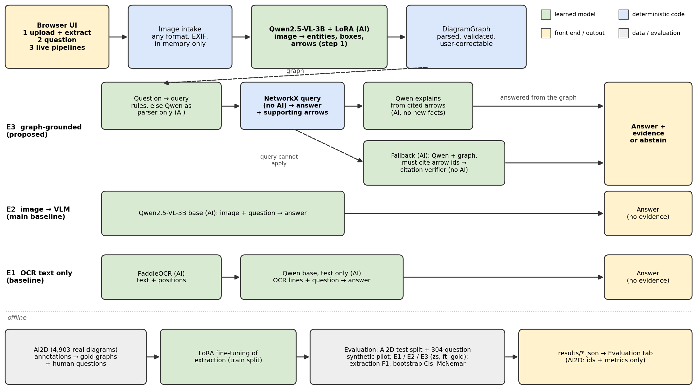

# Architecture

*(Figure source: `scripts/make_figures.py`.)*

## Online data flow (one question in the Ask tab)

1. **Image intake** (`POST /api/extract`, `studylens/uploads.py`). The bytes are decoded with
   Pillow, so the file extension is not trusted. Accepted formats are PNG, JPEG, WebP, BMP, GIF
   (first frame), TIFF (first page) and HEIC/HEIF. Intake then:
   * applies EXIF orientation,
   * flattens transparency onto white,
   * converts any colour mode to 8-bit RGB,
   * upscales tiny images,
   * enforces limits of 10 MB and 40 MP.

   Images are kept in memory only.
2. **Diagram Scene Graph extraction** (`studylens/dsg.py`, `POST /api/extract_stream`). OCR-anchored, so
   the model never writes coordinates:
   * **OCR (PaddleOCR):** every text item with an exact box. Arrowheads misread as text ("V", "-") are
     filtered by confidence.
   * **Parts (no AI):** OCR lines are grouped into part labels. Lines inside the same enclosing shape
     form one label, as do stacked lines. The topmost text outside any shape is the title.
   * **Arrows (AI):** a **Mask R-CNN arrow detector** trained on AI2D (`arrows.py`) finds each drawn arrow
     and arrowhead; the arrow's two ends are attached to the nearest parts and its direction comes from
     the arrowhead (no AI in that step). Without the detector's weights, Qwen2.5-VL sees the image and the
     list of part *names* and lists the drawn arrows by name, matched back to parts deterministically.
   * **Regions (mostly no AI):** for each part, the shape enclosing its label is found by image
     analysis (`regions.enclosing_box`). Parts not inside a shape (e.g. anatomy labels with leader lines)
     are located with **one** batch grounding call to Qwen. Otherwise the label box is used. Each part
     records its `region_source` (shape / grounded / label). A part whose position came only from its label
     text is listed in answers but not highlighted (`explain.gate_boxes`); those positions were right
     only 6 times in 68 on the AI2D dev set.

   Without the OCR environment, the older one-call extraction is used (`EXTRACTION_MODE=legacy`).
3. **Review and correct** (browser). The graph is drawn over the image and listed with arrow
   ids (`e1`, `e2`…). The student can delete wrong arrows or add missing ones.
4. **Ask: the StudyLens answer** (`POST /api/ask_stream`, pipeline `EX`, `studylens/explain.py`).
   1. **Graph facts (no AI where possible):** the question goes through the graph-query engine
      (`query.structured_answer`). For a structural question, NetworkX computes the answer and its arrows.
   2. **Explanation (AI):** Qwen gets the image, the part names, the extracted arrows and the computed
      facts, and writes a 3–6 sentence explanation.
   3. **Reference linking (no AI):** every mention of a part name is linked to that part of the scene
      graph (exact, case-insensitive, plurals; one-letter labels only with a cue word). Consecutive
      mentions joined by graph arrows become a **flow** reference, and the arrows behind a NetworkX answer
      become one too. References are computed, never generated.
   4. **UI:** each reference is a chip. Clicking a part spotlights its region (the rest is dimmed); clicking
      a flow animates its arrows one by one.
5. **Compare with plain AI** (on demand; pipelines E1, E2 and E3 in `studylens/pipelines.py`):
   * **E1:** PaddleOCR text → Qwen, text only.
   * **E2:** image → Qwen.
   * **E3:** graph query → NetworkX, or a model fallback with checked arrow citations.

   These are the conditions measured in the evaluations. Each streams its stages, which the UI draws
   live as architecture diagrams.

The server is stateless: the image, graph and question are sent with every request, and
nothing is stored. Without the model (`EXTRACTOR_BACKEND=annotation`), only the bundled samples
can be loaded. E3 then answers rule-recognised questions with NetworkX, and E1/E2 report that no
model is loaded. The UI says so.

**What a correct graph buys, and what it does not.** E3's answers are deterministic and traceable
to arrows, but only as correct as the extracted graph. On dense, out-of-domain diagrams (e.g.
large software architectures) extraction is the bottleneck: the query then returns confident
answers from a wrong graph. That is why the graph is shown and editable before asking.

## Design decisions forced by measurements

| Tried | Measured | Decision |
|---|---|---|
| One JSON call returning entities + boxes + arrows, zero-shot | Box centre inside the true box only **11%** (pilot, 108 boxes): the model invented a stacked layout | Boxes come from OCR + shape analysis; the model never writes coordinates |
| The same with the fine-tuned adapter | Centres right (97%), but boxes wrap the label text, not the shape | Same as above |
| Enclosing-shape detection from the OCR box | **144/149** pilot labels found, all with IoU ≥ 0.7 to the true box | Default region for boxed diagrams |
| Leader-line tracing (follow the line from a label to its tip) | Tip within 5% of the image diagonal for **35.6%** of 10,857 AI2D train leader lines | Not used (kept as an experiment) |
| Qwen grounding, one call per label | Box contains the leader-line tip for **18/32** AI2D parts labels; ~13 s per call | Replaced by the batch call below |
| Qwen grounding, one call per diagram | **18/32**, fewer boxes on the label text (3 vs 7), ~40 s per diagram | Used for parts outside shapes |
| Arrows by numbered part id (p1, p2…) | The 3B model chained the list in order (p1→p2→p3…) | Arrows are asked for by **name** (arrow F1 0.67–0.91 on pilot diagrams) |
| Model writes reference ids `[n7]` itself | It ignored the instruction (0 references) | References are **linked deterministically** from part names |

## Offline pipeline (training and evaluation)

| Step | Script | What happens |
|---|---|---|
| Data | `scripts/get_ai2d.py` | Downloads AI2D after `--accept-license`, into git-ignored `external/ai2d/` |
| Gold graphs | `studylens/datasets/ai2d.py` | Annotations → `DiagramGraph`. Text labels become nodes, blobs are mapped to their nearest label, directed `interObjectLinkage` relations become arrows |
| Fine-tuning | `scripts/train_lora.py` | LoRA on the language-model attention projections. Target = gold graph as compact JSON; loss on target tokens only |
| Pilot | `scripts/make_synthetic.py`, `scripts/evaluate.py` | 27 generated diagrams, 304 questions with exact gold answers (knowledge-free and counterfactual diagrams included); E1 / E2 / E3 |
| Grounded explanations | `scripts/evaluate_grounding.py` | AI2D test sample: do highlighted references land on the annotated part (leader-line tip / labelled object)? StudyLens vs the same VLM with native grounding (B2); multiple-choice E2 vs E3 |
| Full runs on a GPU | `notebooks/colab_full_eval.ipynb` | Colab notebook (Drive-backed, resumable) for the full AI2D test split |
| Evaluation | `scripts/evaluate_ai2d.py` | Official AI2D **test** split. Extraction F1 (zero-shot vs fine-tuned) and QA accuracy for E1 / E2 / E3-vlm / E3-zs / E3-ft / E3*, overall and on relationship questions, with bootstrap CIs and exact McNemar tests |
| Results UI | Evaluation tab (`/api/eval/*`) | Reads `results/*.json` (ids and metrics only). Question text and images are joined from the local AI2D copy if present |

## Components

| Component | Tech | Role |
|---|---|---|
| Front end | Vanilla HTML/CSS/JS (`studylens/static/`) | Ask tab (1. upload + extraction + graph editing, 2. question + suggestions, 3. live E1/E2/E3 pipeline diagrams) and Evaluation tab |
| API | FastAPI + Uvicorn (`studylens/app.py`) | Stateless endpoints and static files |
| Extraction model | Qwen2.5-VL-3B + LoRA via `transformers` + `peft` (`extractors/qwen_vl.py`) | Image → graph |
| Arrow detector | torchvision Mask R-CNN trained on AI2D arrows/arrowheads (`arrows.py`) | Drawn arrows → directed edges between parts |
| Query parser | Rules (`graph_qa.rule_parse`, `query.food_web_parse`), else Qwen text-only (`query.PARSE_PROMPT`) | Question → structured graph operation |
| Graph query | NetworkX (`graph_qa.execute`, `query.match_options`) | Deterministic E3 answer + supporting arrows |
| QA model | Same base weights, adapter disabled (`qa_nl.py`) | Explanations; E3 fallback with cited arrow ids; E1 and E2 answers |
| Verifier | Pure Python (`qa_nl.verify`) | Citation checks and status |
| OCR | PaddleOCR 3.7 (PP-OCRv5 mobile), separate venv (`studylens/ocr/`) | E1 baseline input |
| Pipelines | `studylens/pipelines.py` | E1/E2/E3 as event streams; `combine_e3` decision rule |
| Data | AI2D loader (`datasets/ai2d.py`); synthetic generator (`scripts/make_synthetic.py`) | Real train/test data; small synthetic stress set |

## Memory and hardware notes

* Inference: about 7.5 GB (bf16) on Apple-silicon MPS or CUDA. CPU works but is slow.
* Training on a 16 GB Apple M4 needed three changes to avoid swapping:
  * logits only for target tokens (`logits_to_keep`);
  * LoRA on attention projections only;
  * training images ≤ 448 px.

  Peak GPU memory was about 8.5 GB, at about 19 s per example.
* Only one model process fits in memory at a time on 16 GB. Stop the web app before training
  or evaluating.

## Deviations from the Phase 1 proposal

| Proposal | Now | Reason |
|---|---|---|
| Next.js front end | Static HTML/JS served by FastAPI | One process, no Node toolchain |
| PaddleOCR for labels | PaddleOCR is used for the **E1 baseline**; extraction relies on Qwen reading labels (entity F1 is reported) | OCR runs in its own venv because its numpy/PyYAML pins conflict with PyTorch |
| PostgreSQL / Docker | None; stateless | No user data is stored |
| E3: deterministic NetworkX query for structural questions, language model explains | Implemented: rules or a Qwen parser → NetworkX → answer + arrows, Qwen explanation; model fallback with checked citations when the query cannot apply | As proposed, with an explicit fallback rule |
| 70/10/20 seeded split | AI2D's official train/test split | Standard, and the LoRA never sees test diagrams |
| 200-question pilot on the Hou et al. suite | Own generator: 27 diagrams / 304 questions | The suite has no licence; ours has exact gold answers and counterfactuals |
| Quiz generation, PDF input, history | Not implemented | Stretch goals; question *suggestions* are generated from the graph instead |
| AI2D licence "CC BY-SA" | **Wrong**: the archive's `license.txt` is an AI2 non-commercial licence with no redistribution | Data is kept out of the repo (see `docs/data.md`) |
